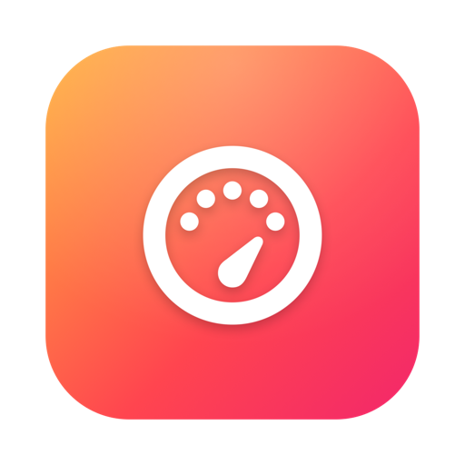

<div align="center">



# Redline

**Push your Mac to the redline.**

[](LICENSE)
[](#requirements)
[](#requirements)
[](https://github.com/marco-scheffler/redline/releases/latest)

A native macOS app that drives your CPU, GPU, memory and disk to their limits —
with a live system monitor — all in one window that looks like part of macOS.

</div>

---

## Why?

Sometimes you need to *know* how your Mac behaves under load — checking thermals,
validating a fresh machine, burning in new hardware, or just seeing how far it goes.
Most stress tools are either command-line gymnastics or cross-platform apps that
feel foreign on a Mac.

Redline is the alternative: **one native SwiftUI window** that saturates every
subsystem on demand and shows you exactly what's happening, in real time.

## Highlights

- 🧮 **CPU** — multi-core load across every logical core, with Float / Integer /
  Mixed workloads and an optional auto-stop timer
- 🎮 **GPU (Metal)** — a heavy compute kernel saturates the GPU; configurable
  buffer size, live iterations/sec
- 🧠 **Memory** — allocates and continuously touches a chosen amount of RAM
- 💽 **Disk I/O** — sequential / random read & write throughput (cache-bypassing)
- 📊 **Live system monitor** — overall CPU / memory / swap plus a per-core grid,
  sampled natively via Mach/sysctl, with a timestamped activity log
- 🎨 **Looks like a Mac app should** — SF Symbols, vibrancy, native controls, and a
  single Start/Stop toggle per test

## Install

### Option A — Download (recommended)

1. Grab the latest **Redline-x.y.z.zip** from
   [Releases](https://github.com/marco-scheffler/redline/releases/latest).
2. Unzip and drag `Redline.app` into `/Applications`.
3. The build is unsigned, so on first launch right-click the app → **Open**, then
   confirm once to let Gatekeeper through.

### Option B — Build from source

```bash
git clone https://github.com/marco-scheffler/redline.git
cd redline
open Redline.xcodeproj    # then press Run (⌘R)
```

The Xcode project is committed, so it opens and runs without any extra tooling.
It is generated from `project.yml` with
[XcodeGen](https://github.com/yonaskolb/XcodeGen); regenerate it only if you change
the project layout (`xcodegen generate`).

## How to use

1. Pick the resource you want to hammer (CPU, GPU, Memory, Disk) and tune its options.
2. Press **Start** on that card — the icon lights up and the live monitor reacts.
3. Press it again to **Stop**, or use **Run All Tests** / **Stop All** at the bottom.

Watch the per-core grid and the CPU / memory / swap gauges to see the impact as it happens.

## Requirements

- macOS 14 (Sonoma) or later — built with the macOS 26 SDK, runs through macOS 26
- Apple Silicon
- Xcode 26+ to build from source (includes the Metal toolchain component)

## Notes

Redline deliberately drives your hardware hard, which raises temperatures and fan
speed. Keep an eye on thermals and use **Stop All** (or quit) to end every running
test and release allocated memory.

## License

[MIT](LICENSE) © 2026 marco-scheffler

---

<div align="center">

Built with SwiftUI, Metal and Mach — no third-party dependencies.

</div>
